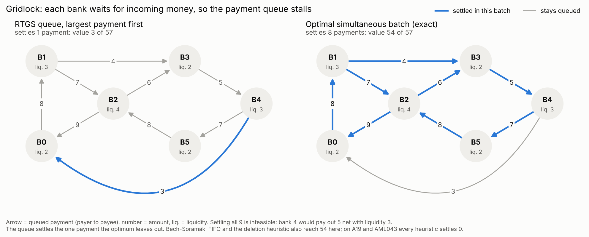
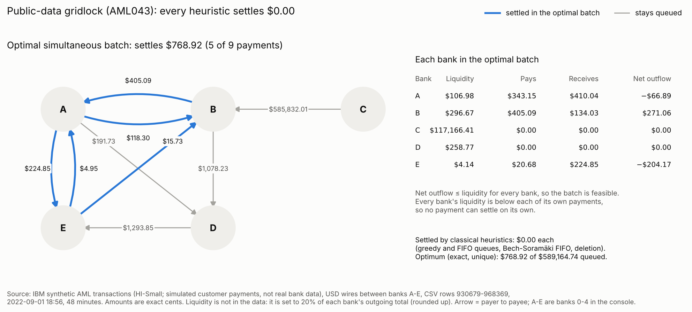

# Gridlock Encodings: how constraint encoding changes QAOA on interbank payment gridlock

**Theme:** Quantum Impact · **Team:** Random Qubit (solo: Jiya Maurya) · **Licence:** MIT (code), CDLA-Sharing-1.0 (derived AML data)
**Demo video (3 min):** VIDEO_LINK · **https://youtu.be/lA4ikg_dDys ** [GitHub](https://github.com/jiya-m12/project_dart_gridlock_encodings) (same files as this project) · **Prior work:** [my earlier notebook](https://github.com/jiya-m12/qubo-interbank-settlement), disclosed below

This effort is supported by Qollab & IonQ.

## Judges: start here
1. Press **Run** with the defaults: built-in simulator, instance `AML043` (public data), encoding `E2`. It takes about 10-30 s, mostly loading packages.
2. Read the console from top to bottom:
   - **[1] Classical baselines.** On this public-data batch the RTGS queue, the Bech-Soramäki gridlock algorithm and a deletion heuristic all settle **USD 0.00**. The exact optimum settles **USD 768.92** by settling five payments together.
   - **[2] Five encodings** of the same problem: qubits, gates per QAOA layer, and whether each one's minimum is the true optimum.
   - **[3] QAOA** angles optimised on an exact simulation.
   - **[4] One sampled run** on the selected backend, compared with the exact value and with random guessing.
3. Then set `mode = results` to see the full offline benchmark as text bars.
4. Optional, on IonQ: select the **IonQ Aria 1 simulator**, then `mode = compare, instance = A19, p = 1, shots = 500`. Four encodings run side by side in one 25-qubit circuit, i.e. one IonQ job. A single noisy run at p = 1 does not rank encodings.

## In short
- **Problem.** Banks pay each other in real time, and each bank can only pay out the cash it holds. When every bank waits for incoming money, the payment queue **gridlocks**. Settling a well-chosen set of payments at the same instant breaks it.
- **What I built.** I gave this problem to QAOA in **five different encodings** of the liquidity constraints. I measured what each choice does to qubits, gates, penalty tuning and the chance of sampling the optimal settlement, on 80 generated instances and 22 gridlocked batches from a public dataset. Every result is checked against the exact optimum.
- **Headline.** The choice of encoding changes QAOA's chance of finding the optimum by up to about 8×. On tier T0, built so that all five encodings fit in a simulator, the slack-free indicator penalty (E2) samples the optimum with median probability 0.270, against 0.032 for textbook binary slack (E0). E2 also needs 9 qubits on the gridlock example where E0 needs 34.
- **Honest bar.** There is **no quantum advantage** here. Exact classical solvers take at most 0.32 s at these sizes, simple heuristics often find the optimum, and an unentangled control beats QAOA on every instance. The contribution is a controlled, reproducible guide to encoding this problem for quantum hardware, including the negative results.

## Judging criteria and theme fit
- **Novelty.** A controlled comparison of five ways to encode liquidity constraints for QAOA (textbook slack, fewest-slack IQP, slack-free step and overflow² penalties, unbalanced penalization) under one protocol, on interbank gridlock, including public data in exact cents. The step penalty uses Lee, Goh & Lau's Walsh custom-penalty construction, which they tested on one 6-qubit knapsack while calling for systematic benchmarks against slack and unbalanced penalization on multiply-constrained problems; this is one such benchmark, with one constraint per bank.
- **Technical execution.** Every encoding's minimum is checked against the exact optimum on every instance, and the Qiskit circuits agree with the simulator to within 3e-15. The CVaR objective was chosen on separate training instances and E3's weights were tuned on separate seeds; the two protocol amendments apply to every result, and earlier results are archived. Five test files.
- **Impact (theme fit).** Public dataset: IBM AML, 548 batches. Classical baseline: RTGS queue, Bech-Soramäki FIFO, deletion heuristic, exact MILP, and an unentangled control. Where the quantum subroutine makes a measurable difference: the encoding decides whether the problem fits on a device (at cents, slack needs a median of 84 qubits against 8) and how often QAOA finds the optimum (up to 8× on generated sets; on public data E1 and E2 are within 20%). Under noise at IonQ Aria's published gate fidelity, E2's lead over E1 survives only when both are compiled to native gates; shipped naively, E2 falls behind at higher noise. Where it does not: against classical methods at these sizes. Under my batching and liquidity rule, the queue leaves USD 1.07M (10.6%) of the optimal USD 10.05M unsettled across the 548 batches, and simple heuristics recover all but USD 11,116, on 2 batches.
- **Documentation.** One-click Run with a guided console; every number is regenerated by shipped scripts; definitions, data provenance and disclosure are in METHOD.md, DATA.md, RESULTS.md and DISCLOSURE.md.

## Why it matters, and who it is for
- **Why it matters.** Gridlock resolution is a real tool in payment systems (Bech & Soramäki 2001), and a team from the Bank of Italy, Intesa Sanpaolo and universities has already run securities settlement on IBM quantum hardware (Martini et al. 2025). Before any quantum method can help, the liquidity constraints have to be written as a penalty. That choice decides whether the problem fits on a device at all. At exact cents, textbook slack needs a median of 84 qubits per batch, while E1 and E2 need 8, small enough for a 25-qubit IonQ simulator.
- **Who it is for:**
  - People building quantum optimisation for finance, who need to know which encoding to use and which ones break at real amounts.
  - Payment-system teams evaluating quantum pilots, who need the honest bar a quantum method must clear: exact solvers, simple heuristics and an unentangled control.
  - Anyone encoding "stay within a budget" constraints that touch only a few variables each; the same five encodings apply.

## The problem: payment gridlock
In a real-time gross settlement (RTGS) system, a payment settles only if the payer has the cash right now. Banks hold much less cash than they pay out in a day, so they rely on incoming payments to fund outgoing ones. If every bank in a group is waiting on another, nothing moves.

*Six banks, nine queued payments. Paying the largest payment first settles one payment worth 3. Settling eight payments at the same instant settles 54 of 57, because each bank's incoming payments fund its outgoing ones.*

**Formally.** Payment k goes from bank aₖ to bank bₖ with amount wₖ, and bank u holds liquidity Cᵤ. Choose xₖ ∈ {0, 1} to

- maximise Σ wₖxₖ (the value settled),
- subject to, for every bank u: (paid out by u) − (received by u) ≤ Cᵤ.

**Why it is not trivial, and why I don't claim it is hard here.** Settling payments one at a time can get stuck at zero, so the solver has to pick a whole set together. In general this is NP-hard: one bank paying out with nothing coming in is already a subset-sum problem. But my instances are small (6-10 payments): exact solvers take milliseconds, and simple heuristics often find the optimum. The open question this project tests is not speed. It is **how to hand liquidity constraints to a quantum computer** so that qubit counts stay small and QAOA can still find the answer.

This is the cash-only case of the batch settlement problem studied with quantum methods by Braine et al., Martini et al. and the QT_Settle benchmark (Mayhew).

## Data
- **Public data: 22 gridlocked batches (IBM AML dataset).**
  - Real interbank settlement data is confidential, so I derived batches from the public IBM synthetic AML transactions (Altman et al., NeurIPS 2023; Kaggle; CDLA-Sharing-1.0).
  - I took its 64,244 USD wire payments between different banks and formed 548 batches of 6-9 payments among 3-5 banks, keeping exact cents.
  - Liquidity is not in the data, so it is set by a stated rule: 20%, 30% or 40% of each bank's outgoing total.
  - Every batch records its CSV row numbers. Three scripts rebuild all 548 byte for byte ([DATA.md](https://github.com/jiya-m12/project_dart_gridlock_encodings/blob/main/DATA.md)).
- **What the data shows:**
  - Under this batching and liquidity rule, gridlock is rare: greedy settlement is already optimal on 525 of 548 batches (96%). At every liquidity level tried (10-40%), only 3.5-5.1% of batches are hard.
  - Rounding amounts to small integers (1-10), as many QUBO studies do, changes the optimal answer on 17 of the 22 hard batches. So I keep cents.
- **Generated data: 80 instances** on which the greedy queue misses the optimum, in three tiers:
  - main set: 40 instances, 4-5 banks, 6-8 payments, amounts 1-10;
  - T0: 20 instances with amounts 1-3, small enough for textbook slack to fit in a simulator;
  - C: 20 instances, 6 banks, 10 payments.

*Batch AML043. Every bank's liquidity is below each of its own payments, so no payment can settle on its own. Settling five together clears USD 768.92 of the USD 589,164.74 queued; the USD 585,832.01 payment cannot settle in any batch.*

## Approach
For each batch: compute the classical baselines and the exact optimum, then build five encodings, check that each one's minimum is the true optimum, and run QAOA.

| | Encoding | Type | Qubits, gridlock example | Qubits, public data (median) | Exact? | Source |
|---|---|---|---|---|---|---|
| E0 | Standard binary slack | QUBO | 34 | 84 | yes | textbook (Lucas; Glover et al.) |
| E1 | IQP: fewest slack bits, smallest coefficients | QUBO | 11 | 8 | yes | De Santis et al. |
| E2 | Indicator penalty, no slack | HUBO | 9 | 8 | yes | Bucher et al.; Lee, Goh & Lau; expansion: Hadfield |
| E3 | Unbalanced penalization | QUBO | 9 | 8 (not run) | approximate | Montañez-Barrera et al. |
| E4 | Overflow-squared penalty, no slack | HUBO | 9 | 8 (not run) | yes (fails in float64 at cents) | Bucher et al.; Hess et al.; expansion as E2 |

- **QAOA:** standard X mixer, p = 1-3, CVaR₀.₂₅ objective (chosen on separate training instances before the benchmark), COBYLA, neighbour penalty weights.
- **Simulation:** exact statevector, which agrees with the Qiskit circuits to within 3e-15.
- **Control:** an unentangled product state (one rotation per qubit), with the same optimiser.
- **Baselines:** greedy RTGS queue, Bech-Soramäki FIFO, a deletion heuristic, and the exact optimum (enumeration and MILP).

## How the quantum part works
1. **One qubit per payment.** |1⟩ means "settle this payment". E0 and E1 add slack qubits; E2-E4 add none.
2. **Cost function.** H = −(value settled) + one penalty term per bank, which is zero when the bank stays within its liquidity. Each bank's penalty depends only on that bank's own payments (at most 5).
3. **From penalty to gates.** For E2 the penalty is a constant λᵤ if the bank is overdrawn and 0 otherwise. This on/off function of up to 5 bits is rewritten exactly as a sum of products of Pauli-Z operators (up to 5-body terms), and each term becomes a CNOT ladder around one RZ rotation. No extra qubits are needed. This is the construction Lee, Goh & Lau call Walsh custom-penalty QAOA (arXiv:2610.04908, October 2026), here used untruncated. They tested it on one 6-qubit knapsack and called for systematic benchmarks against slack-based QUBOs and unbalanced penalization; this project is a small benchmark of that kind, on settlement.
4. **QAOA.** Start in an equal superposition of all settlements, then alternate p times between the cost layer exp(−iγH) and the mixer exp(−iβΣX). A classical optimiser (COBYLA) tunes the angles to minimise CVaR₀.₂₅, the average cost of the best 25% of outcomes.
5. **Measure.** Each shot is a candidate settlement. It is checked for feasibility and value, and success is the probability of sampling the exact optimum.

## Results
Median probability that one QAOA sample (p = 3) is the optimal settlement:

| Instance set | E2 indicator | E1 IQP | E3 unbalanced | E4 overflow² | E0 slack | E2, × random guessing | Unentangled control (E2) |
|---|---|---|---|---|---|---|---|
| Main (40) | **0.223** | 0.115 | 0.129 | 0.065 | 0.030 (1 instance fits) | 18.7× | 1.00 |
| T0 (20) | **0.270** | 0.258 | 0.207 | 0.155 | 0.032 | 16.9× | 1.00 |
| C (20) | **0.050** | 0.018 | 0.021 | 0.008 | too large | 44.6× | 1.00 |
| Public data (22) | **0.069** | 0.058 | n/a | n/a | too large | 13.6× | 0.29 |

*Control column: the product state trained on ⟨H⟩. The best-against-best comparison over both objectives and all encodings is under limitations.*

1. **The encoding matters a lot.** E2 has the highest median in every set. Instance by instance, with Holm-corrected Wilcoxon tests, it beats E4 in the three generated sets and E3 on main and T0. It beats E1 on main (29/40) and C (19/20), but not on T0 or the public data (12/22, p = 0.2). These rankings use the CVaR objective. Under the textbook ⟨H⟩ objective, E2 still beats E4 in every generated set, but its lead over E1 holds only on C, on the main set E3's median is higher than E2's (0.103 vs 0.092), and on the public data E1's is (0.048 vs 0.039). What holds under both objectives: E2 beats E4, and on T0 the slack encoding E0.
2. **Slack qubits are the cost.** E0 and E4 encode exactly the same cost once the slack is minimised out (checked on every instance). The only difference is the slack qubits, and on T0 that drops QAOA from 9.7× random (E4) to 1.9× (E0).
3. **Slack also grows with amount precision.** On the gridlock example, E0 needs 34 qubits, rising to 153 at finer amounts. E1 stays at 11 and the slack-free encodings at 9.
4. **Squared penalties break at real amounts.** At exact cents E4's coefficients reach 7.7e26, so after normalisation the optimum and the next-best settlement differ by about 1e-16, below float64 resolution. E3's tuned weights do not transfer to cents. E1 and E2 grow only linearly and stay exact on all 22 public batches.
5. **The trade-off:** E2 needs no slack qubits but uses more two-qubit gates than E1: 44 vs 22 CNOTs per layer (main-set median, plain CNOT ladders). Compiled for IonQ's native ZZ gate, it is 22 vs 11 per layer, still twice E1's.
6. **Penalty weights fail by shape.** With per-bank weights, flat penalties (E1, E2) give a wrong optimum on up to 48% of cases in the tightest setting, against at most 8% for graded ones (E0, E4). Neighbour weights fail on 2 of 360 cases; global weights never do.
7. **Under hardware-like noise, E2's lead depends on compilation.** I re-ran the shipped p = 3 angles, with no re-tuning, under depolarising noise at three two-qubit fidelities: 99.85%, 99.6% (IonQ Aria's published value) and 99.25%. Readout error is 0.5%. Each encoding is run two ways: as shipped (CNOT ladders) and compiled for IonQ's native ZZ gate (E2 also uses Gray-code ordering where it is cheaper). On the main set, compiled fairly (both native), E2 keeps a significant lead over E1 at 99.85% and at Aria's 99.6% (25/40 instances, Holm-adjusted p = 0.03), and loses it at 99.25%. Shipped naively to a device where E1 uses native ZZ, E2 is worse than E1 at 99.25% (14/40, p = 0.007). On the public data there is no significant difference in the fair comparison at any noise level. Script: `scripts/noise_check.py`; full tables in RESULTS.md.

| Main set (40), median P(opt) at p = 3 | 2-qubit gates | noiseless | 99.85% | 99.6% (Aria) | 99.25% |
|---|---|---|---|---|---|
| E1, shipped (2 CNOTs per ZZ) | 66 | 0.115 | 0.096 | 0.081 | 0.061 |
| E1, native ZZ | 33 | 0.115 | 0.103 | 0.092 | 0.080 |
| E2, shipped (CNOT ladder) | 132 | 0.223 | 0.186 | 0.129 | 0.073 |
| E2, native ZZ + Gray code | 66 | 0.223 | 0.203 | 0.162 | 0.121 |

## Honest limitations
- **QAOA loses to an unentangled control on all 102 instances.** The control has one angle per qubit (6-18), at least as many as QAOA's 2p = 6, so it shows an unentangled model is enough at these sizes; it does not isolate entanglement. The measurable difference is between encodings, not quantum vs classical.
- **Classical methods win.** The exact MILP solves every instance in at most 0.32 s. The deletion heuristic or Bech-Soramäki FIFO already finds the optimum on 90 of 103 instances (the 102 benchmark instances plus the gridlock example).
- **Small sizes** (6-10 payments, 6-18 qubits), so every answer can be checked exhaustively.
- **No real settlement data.** The public data is simulated customer payments regrouped into batches that span hours, not minutes, and liquidity is set by a rule. The generated tiers use small uniform amounts.
- **CVaR₀.₂₅ caps the useful P(optimum) near 0.25.** On T0, E2 reaches that cap on 19 of 20 instances, which is partly why E2 and E1 cannot be separated there. The other part: 7 of the 20 T0 instances can settle in full (only the queue gets stuck), and on the remaining 13, E2 beats E1 on 10.
- **Two protocol amendments** were made during the build: a larger optimiser budget, and the sign of the starting angles. Both apply to every result, and the earlier results are archived.
- **The noise check is a model, not hardware.** It uses generic depolarising noise at Aria-like fidelities, not IonQ's own noise model, and angles optimised without noise. It shows how gate count interacts with the encoding; it does not predict device results. The Qollab app still runs the shipped CNOT-ladder circuits.
- **Gate cost grows exponentially with payments per bank.** E2 and E4 expand each bank's penalty exactly into up to 2^d − 1 Pauli-Z terms for a bank with d payments (1,023 at d = 10, 16,383 at d = 14). Gray-code ordering needs at most 2^d − 2 CNOTs per bank per layer, and every multi-body term needs at least one two-qubit gate, so compiling cannot remove the growth. My batches cap d at 5 by construction.
- **No simulated annealing.** The exact MILP solves every instance in at most 0.32 s, so a heuristic can only tie it.

The full list, with every table and statistical test, is in [RESULTS.md](https://github.com/jiya-m12/project_dart_gridlock_encodings/blob/main/RESULTS.md).

## Try more on Qollab
- `instance = B13, tuning = local`: the exactness check fails, a penalty-tuning failure you can see.
- `instance = gridlock6x9, encoding = E0`: refuses to run, because textbook slack needs 34 qubits.
- `instance = T09, mode = compare`: all five encodings side by side, including textbook slack at 13 qubits. Slower, because it optimises all five.
- `instance = gridlock6x9`: the example in the first figure. Here Bech-Soramäki FIFO and the deletion heuristic already find the optimum.
- All settings: `mode` (demo / compare / results), `instance`, `encoding` (E0-E4), `p`, `shots`, `objective` (cvar / mean), `alpha`, `tuning` (local / neighbour / global), `max_qubits`. [RESULTS.md](https://github.com/jiya-m12/project_dart_gridlock_encodings/blob/main/RESULTS.md) lists them all.

## Replicate or extend
- **Run the tests:** `python3 tests/test_core.py` (and the other four files in `tests/`). Requirements: Python 3.11+, numpy, scipy, Qiskit 2.x (tested with 2.5.2).
- **Re-run the benchmark:** `python3 scripts/run_benchmark.py bench t0 c`, about 5 CPU-hours, using all cores. [RESULTS.md](https://github.com/jiya-m12/project_dart_gridlock_encodings/blob/main/RESULTS.md) lists every command.
- **Add your own payments:** append a batch to `data/demo_instances.json` in the same format (`name`, `n_banks`, `arcs` as [payer, payee, amount], `liquidity`), then run with `instance = <its name>`. E1 runs only if its IQP polynomials for that batch are precomputed (`scripts/build_iqp_cache.py`); otherwise it is reported as unavailable.
- **Add an encoding:** a function returning per-bank penalty polynomials (`settle/encodings.py`). It must pass the exactness check and the circuit-vs-simulation test.
- **Files:** `main.py` (Qollab entry), `settle/` (problem, encodings, QAOA), `scripts/` (everything behind the numbers), `results/`, `tests/`. Documentation, readable on GitHub: [RESULTS.md](https://github.com/jiya-m12/project_dart_gridlock_encodings/blob/main/RESULTS.md) (full tables), [METHOD.md](https://github.com/jiya-m12/project_dart_gridlock_encodings/blob/main/METHOD.md) (every definition), [DATA.md](https://github.com/jiya-m12/project_dart_gridlock_encodings/blob/main/DATA.md) (public data), [DISCLOSURE.md](https://github.com/jiya-m12/project_dart_gridlock_encodings/blob/main/DISCLOSURE.md).

## Prior work and disclosure
- **Before the window.** As an earlier independent project, I wrote [a notebook on interbank settlement and counterparty netting](https://github.com/jiya-m12/qubo-interbank-settlement). I took that use case from Quantum Dice's Trinity 2026 Challenge, a probabilistic-computing challenge, and formulated it as a QUBO. Its base formulation has the same objective and liquidity constraint as here. It had a textbook slack QUBO, greedy baselines, simulated annealing, the 6-bank gridlock example, and the IQP + Master-Satellite (IQPMS) penalties of De Santis et al. with coefficient minimisation, which I found work only on gridlock scenarios. This project's E1 uses plain IQP, without the Master-Satellite step. Before kickoff I also used Claude for planning: choosing the problem, prior-art notes, a written spec and a small exploratory check.
- **Carried over:** the formulation, the IQP idea and the gridlock example. No code was reused. Everything else was built in the window: all QAOA and circuits, the three slack-free encodings (E2-E4), the fewest-slack IQP search, both datasets, the controls, the studies and every number.
- **AI assistance:** developed with Anthropic's Claude under my direction. Every number comes from the shipped scripts.
- **Data and libraries:** the IBM AML dataset is CDLA-Sharing-1.0, and the derived files use the same licence. Qiskit, NumPy and SciPy are used unmodified. Details are in [DISCLOSURE.md](https://github.com/jiya-m12/project_dart_gridlock_encodings/blob/main/DISCLOSURE.md).

## Accessibility
- All output on Qollab is plain text, and no result relies on colour.
- The figures pair colour with shape, position or text labels, and each has a text description.

## Key references
- De Santis, Tirone, Marmi, Giovannetti, *Optimized QUBO formulation methods for quantum computing*, arXiv:2406.07681
- Bucher, Stein, Feld, Linnhoff-Popien, *IF-QAOA*, arXiv:2504.08663
- Montañez-Barrera, Willsch, Maldonado-Romo, Michielsen, *Unbalanced penalization*, arXiv:2211.13914
- Hess, Palackal, Awasthi, Wintersperger, arXiv:2403.18395
- Lee, Goh & Lau, *Custom Penalty QAOA via Walsh–Hadamard Transform*, arXiv:2610.04908
- Hadfield, arXiv:1804.09130; Campbell & Dahl, *QAOA of the Highest Order*, arXiv:2111.12754
- Barkoutsos et al., *CVaR*, Quantum 4, 256 (2020)
- Lee & Lau, *Implementing slack-free custom penalty function for QUBO on gate-based quantum computers*, IEEE QCE 2025, pp. 2112-2119, arXiv:2504.12611; Lee & Lau, *CVaR-Assisted Penalties for Constrained Optimization*, arXiv:2604.20088
- Welch, Greenbaum, Mostame, Aspuru-Guzik, *Efficient quantum circuits for diagonal unitaries without ancillas*, New J. Phys. 16, 033040 (2014)
- Martini et al., arXiv:2501.08794; Braine et al., arXiv:1910.05788; Huber et al., arXiv:2307.07193
- Mayhew, QT_Settle, github.com/jontymayhew/quantum-settlement-optimisation
- Altman et al., *Realistic Synthetic Financial Transactions for AML*, arXiv:2306.16424
- Bech & Soramäki (2001), gridlock resolution in interbank payment systems; Güntzer, Jungnickel & Leclerc (1998), bank clearing
- Vivek (2026), SSRN 7416319: simulated-annealing gridlock resolution compared with MILP
