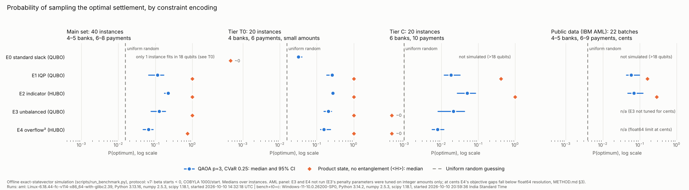
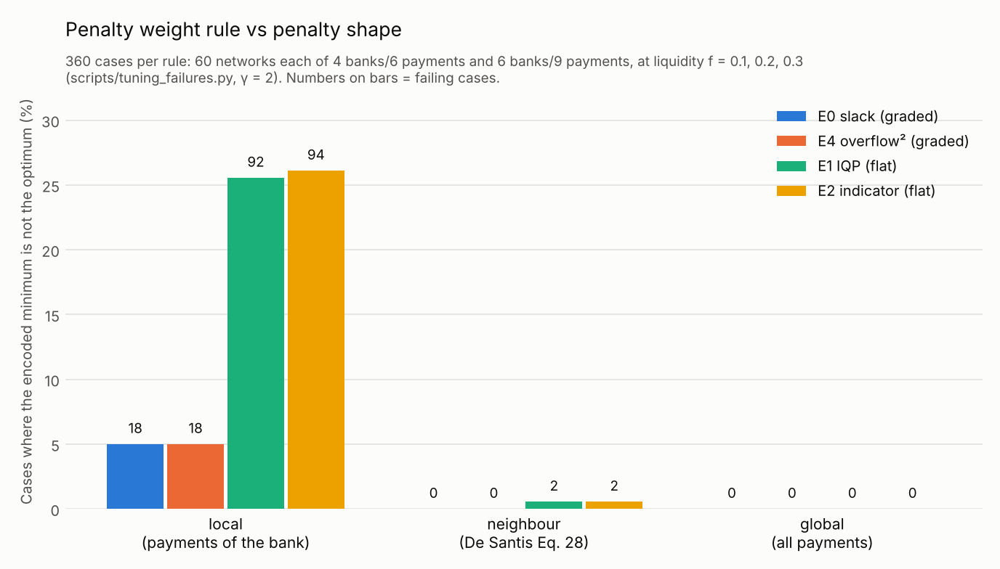
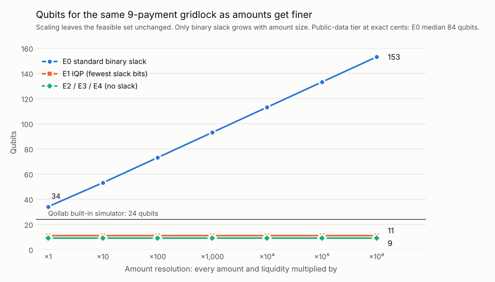

# Full results, limitations and reproduction

This file holds the detail behind the project page (README.md): every table, the full list of limitations, all run settings, and how to reproduce each number. Definitions are in METHOD.md; the public-data tier is documented in DATA.md.

## The five encodings (with sources)
Each bank's constraint touches at most 5 payments (degree cap), so every penalty is a function of at most 5 bits.

| | Encoding | Extra qubits | Form | Exact? | Source |
|---|---|---|---|---|---|
| E0 | standard binary slack, λ(net − C + s)² | ~log₂(C + inflow) per bank | QUBO | yes (with suitable λ) | textbook (Lucas; Glover et al.) |
| E1 | IQP: quadratic P(x,s) with the fewest slack bits; we pick the one with the smallest largest coefficient (MILP) | 0-2 per bank | QUBO | yes | De Santis et al. 2024/26, Sec. III A |
| E2 | constant penalty λ·[bank overdrawn], expanded exactly into Z-terms on the bank's own qubits | 0 | HUBO (up to 5-body) | yes | penalty: Bucher et al. (IF-QAOA), Sec. IV ("Alternative Architectures": a constant penalty per violated constraint); expansion: Hadfield 2018 |
| E3 | unbalanced penalization −λ₁h + λ₂h², h = C − net | 0 | QUBO | **no** (approximate) | Montañez-Barrera et al. 2024 |
| E4 | λ·max(0, net − C)², expanded exactly | 0 | HUBO | yes (but unusable in float64 at cent scale, see limitations) | Bucher et al. Eq. 18, Sec. IV ("virtual penalty", used there only in simulation); Hess et al. Eq. 11 (as a classical sample score) |

**What is ours.** The penalty functions are not new, and compiling higher-order terms straight into QAOA gates is standard practice (Campbell & Dahl, "QAOA of the Highest Order"; Hadfield's Walsh/Pauli-Z expansion). Lee, Goh & Lau (arXiv:2610.04908, October 2026) describe exactly this construction for an arbitrary penalty on a linear constraint ("Walsh custom-penalty QAOA"), including the step penalty used by E2 and the sparse-support shortcut that makes it per-bank here; they test it on one 6-qubit knapsack. Applying IQP with LP-based coefficient minimisation to this settlement problem was already in my earlier notebook (see DISCLOSURE.md). New in the build window:
- the per-bank compilation of the slack-free penalties (E2, E4) on each bank's own payment qubits, with no ancillas and no oracle register. This is engineering rather than a new technique, and it is practical because each bank has at most 5 payments;
- a re-implemented IQP that first finds the fewest slack bits (MILP) and then the smallest largest coefficient, with an independent check that the slack count is minimal;
- the controlled comparison of all five under one QAOA protocol, with an unentangled control;
- the public-data tier and the penalty-tuning study.

## Results (offline, exact statevector)
Protocol (see `scripts/run_benchmark.py` and METHOD.md §4). The objective (CVaR₀.₂₅ primary, ⟨H⟩ secondary) was chosen on separate training instances (`results/pilot_objective.json`) before any benchmark run.
- QAOA with the standard X mixer, p = 1..3, each p warm-started from p−1;
- COBYLA, 1000 iterations per start, 3-4 starts per p;
- neighbour penalty weights (γ = 2);
- objective CVaR₀.₂₅ (primary) and ⟨H⟩ (secondary);
- control: an unentangled product state (one RY per qubit), same objective and budget;
- the standard slack encoding is simulated only where it needs ≤ 18 qubits.

Two amendments were made during the build. Both apply to every encoding and every set, and every shipped result uses both.
1. **Optimiser budget, 300 → 1000 iterations per start.** At 300, 2-3 of the 4 starts at p = 3 stopped on the budget instead of converging.
2. **Sign of the starting mixer angle (v7).** The layer is exp(−iγH)·exp(−iβΣX) and H is minimised, so good angles usually have γ > 0 and β < 0. Up to v6, all starting points used β > 0.
   - One-qubit check: P(ground) is 0.24 with β > 0 and 0.76 with β < 0.
   - A p = 1 grid search over both signs found the best point at β < 0 on 34, 34 and 36 of the 40 main-set instances for E1, E2 and E4, not on all of them (`results/p1_grid_check.json`).
   - The optimiser can still move out of a bad start, so for E1 and E2 the v6 numbers were biased low rather than wrong; E3 and E4 moved in both directions.
   - The re-run raises the median P(opt) at p = 3 for E1 and E2 in every set: main 0.100 → 0.115 and 0.201 → 0.223; T0 0.208 → 0.258 and 0.253 → 0.270; C 0.014 → 0.018 and 0.029 → 0.050. E3 and E4 change by at most 0.023, in either direction.
   - The v6 results are kept in `results/archive_v6_beta_positive/` for comparison.
   - A regression test pins the sign (`tests/test_qaoa_extras.py`).
   - After the fix we re-ran the objective pilot on the same training instances (`results/pilot_objective.json`; the v6 pilot is archived). At p = 3, CVaR₀.₂₅ still gives a higher median P(opt) than ⟨H⟩ for every encoding: E2 0.236 vs 0.095, E1 0.092 vs 0.071, E4 0.055 vs 0.022. So the pre-registered objective stands.
   - The pilot also tested CVaR₀.₁. It gave a slightly higher median than CVaR₀.₂₅ for E1 (0.096 vs 0.092) and E4 (0.078 vs 0.055), but a much lower one for E2 (0.105 vs 0.236), so CVaR₀.₂₅ was best on average over the encodings. The v6 pilot, before the fix, showed the same pattern. Because this choice favours E2, the results under ⟨H⟩ are reported as well (key finding 1).

### Key findings
1. **The encoding changes QAOA's success a lot.**
   - E2 (indicator, no slack) has the highest median P(optimum) at p = 3 in every set:
     - main set 0.223 (18.7× random guessing);
     - T0 0.270;
     - C 0.050 (44.6×);
     - public data 0.069 (13.6×).
   - Instance by instance, with Holm-corrected Wilcoxon tests, E2 beats:
     - E4 on 39/40, 19/20 and 19/20 instances;
     - E3 on 30/40 and 16/20 (main, T0);
     - E1 on 29/40 (main) and 19/20 (C).
   - E2 does **not** beat E1 significantly on T0 (12/20, where E2 is at the CVaR ceiling on 19/20) or on the public data (12/22, p = 0.2).
     - On T0, 7 of the 20 instances can settle in full: the queue gets stuck, but settling everything is feasible. On the other 13, E2 beats E1 on 10 (Wilcoxon p = 0.003; a subgroup chosen after the fact). The AML filter excludes such batches; in the main set there are 5 of 40.
   - **Under the secondary objective ⟨H⟩ the picture is weaker** (Holm-adjusted p, `results/summary.json`):
     - E2 still beats E4 in every generated set: 34/40 (p = 4e-06), 15/20 (p = 0.007), 20/20 (p = 1e-05).
     - E2 beats E1 only on C (18/20, p = 8e-05); not on main (25/40, p = 0.43), T0 (13/20, p = 0.07) or the public data (13/22, p = 0.35, and E1 has the higher median there, 0.048 vs 0.039).
     - E2 does not beat E3 anywhere; on the main set E3's median is higher (0.103 vs 0.092).
     - So what holds under both objectives is that E2 beats the graded penalty E4, and on T0 the slack encoding E0, in every set where they were run. Which of E1, E2 and E3 is best depends on the objective.
2. **Slack is the cost.**
   - E0 (slack) and E4 (no slack) have exactly the same cost once the slack is minimised out: we checked that the difference is 0 on every instance. So comparing E0 with E4 isolates the slack qubits.
   - On T0, E0 reaches 1.9× random and E4 9.7×; E4 is better on 19/19 instances.
3. **E2 vs E4 mixes penalty shape with scale.** After normalising H, the settlement value is about 50× less visible in E4 than in E2: median objective visibility 0.0044 vs 0.225 on the main set (lines under each table).
4. **QAOA loses to an unentangled control.** The best product-state run beats the best QAOA run on all 102 instances (see limitations).
5. **Classical heuristics are strong.** The optimum beats every heuristic on only 13 of 103 instances.



*Figure: median P(optimum) per encoding (blue dot, 95% CI) against the unentangled product-state control (orange diamond) and uniform random guessing (dashed line), log scale. The same numbers are in the tables below.*

<!-- RESULTS -->
**Main set (40 instances, 4-5 banks, 6-8 payments, amounts 1-10)**

| Encoding | exact | qubits | CNOT/layer | P(opt) p=3, CVaR [95% CI] | × random | P(feasible) | product state P(opt) (⟨H⟩) |
|---|---|---|---|---|---|---|---|
| E0 standard slack | 1/1 | 16 | 102 | 0.030 (n = 1, no CI) | 1.9× | 0.63 | 0.00 (> 0.9 on 0/1) |
| E1 IQP | 40/40 | 8.5 | 22 | 0.115 [0.065, 0.167] | 15.0× | 0.57 | 1.00 (> 0.9 on 31/40) |
| E2 indicator | 40/40 | 7 | 44 | 0.223 [0.177, 0.251] | 18.7× | 0.55 | 1.00 (> 0.9 on 38/40) |
| E3 unbalanced | 21/40 | 7 | 25 | 0.129 [0.077, 0.189] | 12.8× | 0.33 | 1.00 (> 0.9 on 21/40) |
| E4 overflow² | 40/40 | 7 | 62 | 0.065 [0.046, 0.086] | 6.2× | 0.33 | 0.75 (> 0.9 on 17/40) |

Paired, P(opt) at p = 3, CVaR — E2 compared with each other encoding: E2 vs E1: E2 better on 29/40 (Wilcoxon p = 0.0001, Holm-adjusted 0.0004); E2 vs E3: E2 better on 30/40 (Wilcoxon p = 3e-05, Holm-adjusted 0.0001); E2 vs E4: E2 better on 39/40 (Wilcoxon p = 2e-11, Holm-adjusted 1e-10)

Objective visibility after normalisation (max |objective coefficient| / max |coefficient|, median): E0 0.00045, E1 0.12, E2 0.23, E3 0.42, E4 0.0044.

Unentangled control: the best product-state run (any encoding, either objective) beats the best QAOA p = 3 run on 40/40 instances. Per encoding: E0 1/1, E1 38/40, E2 39/40, E3 26/40, E4 39/40.

CVaR ceiling (proxy): runs whose P(opt) at p = 3 reached ≈ α = 0.25, beyond which CVaR₀.₂₅ gives no further reward (for E0/E1 the slack must also be right; for E3 the minimum need not be the optimum): E0 0/1, E1 11/40, E2 19/40, E3 8/40, E4 0/40.

**Tier T0 (20 instances, 4 banks, 6 payments, amounts 1-3; E0 fits in ≤ 18 qubits)**

| Encoding | exact | qubits | CNOT/layer | P(opt) p=3, CVaR [95% CI] | × random | P(feasible) | product state P(opt) (⟨H⟩) |
|---|---|---|---|---|---|---|---|
| E0 standard slack | 19/19 | 15 | 102 | 0.032 [0.028, 0.039] | 1.9× | 0.52 | 0.00 (> 0.9 on 6/19) |
| E1 IQP | 20/20 | 8 | 23 | 0.258 [0.184, 0.285] | 16.5× | 0.71 | 1.00 (> 0.9 on 15/20) |
| E2 indicator | 20/20 | 6 | 46 | 0.270 [0.253, 0.283] | 16.9× | 0.79 | 1.00 (> 0.9 on 20/20) |
| E3 unbalanced | 14/20 | 6 | 22 | 0.207 [0.155, 0.252] | 12.8× | 0.65 | 1.00 (> 0.9 on 14/20) |
| E4 overflow² | 20/20 | 6 | 52 | 0.155 [0.124, 0.235] | 9.7× | 0.69 | 1.00 (> 0.9 on 19/20) |

Paired, P(opt) at p = 3, CVaR — E2 compared with each other encoding: E2 vs E0: E2 better on 19/19 (Wilcoxon p = 4e-06, Holm-adjusted 4e-05); E2 vs E1: E2 better on 12/20 (Wilcoxon p = 0.08, Holm-adjusted 0.2); E2 vs E3: E2 better on 16/20 (Wilcoxon p = 0.0003, Holm-adjusted 0.002); E2 vs E4: E2 better on 19/20 (Wilcoxon p = 6e-06, Holm-adjusted 4e-05)

Objective visibility after normalisation (max |objective coefficient| / max |coefficient|, median): E0 0.0058, E1 0.12, E2 0.23, E3 0.4, E4 0.054.

Unentangled control: the best product-state run (any encoding, either objective) beats the best QAOA p = 3 run on 20/20 instances. Per encoding: E0 15/19, E1 18/20, E2 20/20, E3 15/20, E4 20/20.

CVaR ceiling (proxy): runs whose P(opt) at p = 3 reached ≈ α = 0.25, beyond which CVaR₀.₂₅ gives no further reward (for E0/E1 the slack must also be right; for E3 the minimum need not be the optimum): E0 0/19, E1 11/20, E2 19/20, E3 9/20, E4 6/20.

**Tier C (20 instances, 6 banks, 10 payments, amounts 1-10)**

| Encoding | exact | qubits | CNOT/layer | P(opt) p=3, CVaR [95% CI] | × random | P(feasible) | product state P(opt) (⟨H⟩) |
|---|---|---|---|---|---|---|---|
| E0 standard slack | – | – | – | not simulated (> 18 qubits on all 20 instances) | | | |
| E1 IQP | 20/20 | 13 | 41 | 0.018 [0.012, 0.032] | 13.8× | 0.47 | 0.41 (> 0.9 on 9/20) |
| E2 indicator | 20/20 | 10 | 78 | 0.050 [0.027, 0.085] | 44.6× | 0.47 | 1.00 (> 0.9 on 15/20) |
| E3 unbalanced | 4/20 | 10 | 46 | 0.021 [0.008, 0.042] | 18.1× | 0.19 | 0.00 (> 0.9 on 4/20) |
| E4 overflow² | 20/20 | 10 | 143 | 0.008 [0.006, 0.012] | 7.5× | 0.24 | 0.00 (> 0.9 on 1/20) |

Paired, P(opt) at p = 3, CVaR — E2 compared with each other encoding: E2 vs E1: E2 better on 19/20 (Wilcoxon p = 1e-05, Holm-adjusted 7e-05); E2 vs E3: E2 better on 15/20 (Wilcoxon p = 0.03, Holm-adjusted 0.06); E2 vs E4: E2 better on 19/20 (Wilcoxon p = 4e-06, Holm-adjusted 2e-05)

Objective visibility after normalisation (max |objective coefficient| / max |coefficient|, median): E0 0.00034, E1 0.088, E2 0.18, E3 0.24, E4 0.0024.

Unentangled control: the best product-state run (any encoding, either objective) beats the best QAOA p = 3 run on 20/20 instances. Per encoding: E1 18/20, E2 19/20, E3 6/20, E4 19/20.

CVaR ceiling (proxy): runs whose P(opt) at p = 3 reached ≈ α = 0.25, beyond which CVaR₀.₂₅ gives no further reward (for E0/E1 the slack must also be right; for E3 the minimum need not be the optimum): E1 0/20, E2 0/20, E3 0/20, E4 0/20.

**Public-data tier AML (22 hard batches, 4-5 banks, 6-9 payments, exact US cents; IBM AML dataset, see DATA.md)**

| Encoding | exact | qubits | CNOT/layer | P(opt) p=3, CVaR [95% CI] | × random | P(feasible) | product state P(opt) (⟨H⟩) |
|---|---|---|---|---|---|---|---|
| E0 standard slack | – | – | – | not simulated (> 18 qubits on all 22 instances) | | | |
| E1 IQP | 22/22 | 8 | 9 | 0.058 [0.043, 0.099] | 10.4× | 0.57 | 0.16 (> 0.9 on 3/22) |
| E2 indicator | 22/22 | 8 | 16 | 0.069 [0.047, 0.121] | 13.6× | 0.59 | 0.29 (> 0.9 on 2/22) |
| E3 unbalanced | – | – | – | n/a: E3 weights were tuned in small-integer units and do not transfer to cents | | | |
| E4 overflow² | – | – | – | n/a: at cents the optimum and other settlements differ by ~1e-16 after normalisation (float64 limit) | | | |

Paired, P(opt) at p = 3, CVaR — E2 compared with each other encoding: E2 vs E1: E2 better on 12/22 (Wilcoxon p = 0.2, Holm-adjusted 0.2)

Objective visibility after normalisation (max |objective coefficient| / max |coefficient|, median): E0 1.4e-14, E1 0.33, E2 0.44, E4 2.8e-14.

Unentangled control: the best product-state run (any encoding, either objective) beats the best QAOA p = 3 run on 22/22 instances. Per encoding: E1 22/22, E2 22/22.

CVaR ceiling (proxy): runs whose P(opt) at p = 3 reached ≈ α = 0.25, beyond which CVaR₀.₂₅ gives no further reward (for E0/E1 the slack must also be right; for E3 the minimum need not be the optimum): E1 2/22, E2 2/22.

Medians over instances; 95% bootstrap CIs. *exact* = encoded minimum is the true optimum. *× random* = P(opt) divided by uniform random guessing. Full numbers (p = 1, 2, 3; both objectives; optimiser convergence) in `results/summary.json`; raw per-instance results in `results/*_raw.jsonl`.
<!-- /RESULTS -->

### Penalty tuning and qubit cost
- **Penalty tuning fails by penalty shape** (`results/tuning_failures.json`, 360 cases per rule):
  - With per-bank (local) weights, flat penalties (IQP, indicator) give a wrong optimum on up to 48% of the cases in one cell, against at most 8% for the graded penalties (slack, overflow²).
  - Neighbour weights (De Santis Eq. 28) fail on 2 of 360 cases: one payment network, at two liquidity levels.
  - Global weights never fail, and are provably exact.



- **Slack is expensive in qubits:**
  - On the gridlock example, standard slack needs 34 qubits, rising to 153 at finer amount resolution. IQP stays at 11 and the slack-free encodings at 9 (`results/qubits_vs_amounts.json`).
  - At cent amounts (AML), standard slack needs a median of 84 qubits.



## Noise check (offline, `scripts/noise_check.py`)
The shipped p = 3 CVaR angles are re-evaluated, without re-optimisation, with Qiskit Aer's density-matrix simulator.

**Noise model (depolarising):**
- parameter e on every two-qubit gate (CX or RZZ), and e/5 on H and RX;
- RZ is virtual and error-free;
- 0.5% symmetric readout error per qubit;
- e = 0.002, 0.005 and 0.01, i.e. average fidelity 1 − 0.75e = 99.85%, 99.6% and 99.25% for two-qubit gates, and 99.95% for one-qubit gates at e = 0.005. These match IonQ Aria's listed 99.6% / 99.95%.

**Connectivity:** all-to-all, as on trapped ions, so no SWAPs.

**Compiled variants (each the same unitary as the shipped circuit):**
- E1 native ZZ: one native RZZ per ZZ term.
- E2 Gray only: per bank, Gray-code ordering (Welch et al. 2014) where it is cheaper than the CNOT ladder.
- E2 native ZZ + Gray: per bank, the cheaper of Gray-code ordering and a CNOT ladder with a native RZZ core.

**Checks:**
- Noiseless P(opt) equals the shipped P(opt) on all 310 rows (max difference 1.3e-15).
- Every compiled variant equals its shipped circuit when noiseless.

| Set | Variant | 2q gates (p = 3) | noiseless | e = 0.002 | e = 0.005 | e = 0.01 |
|---|---|---|---|---|---|---|
| Main (40) | E1 shipped | 66 | 0.115 | 0.096 | 0.081 | 0.061 |
| Main (40) | E1 native ZZ | 33 | 0.115 | 0.103 | 0.092 | 0.080 |
| Main (40) | E2 shipped | 132 | 0.223 | 0.186 | 0.129 | 0.073 |
| Main (40) | E2 Gray only | 78 | 0.223 | 0.200 | 0.154 | 0.119 |
| Main (40) | E2 native ZZ + Gray | 66 | 0.223 | 0.203 | 0.162 | 0.121 |
| Public (22) | E1 shipped | 27 | 0.058 | 0.054 | 0.051 | 0.048 |
| Public (22) | E1 native ZZ | 13 | 0.058 | 0.055 | 0.053 | 0.050 |
| Public (22) | E2 shipped | 48 | 0.069 | 0.062 | 0.053 | 0.045 |
| Public (22) | E2 native ZZ + Gray | 28 | 0.069 | 0.062 | 0.061 | 0.053 |

Paired, main set. Each entry gives E2 wins/losses/ties and the two-sided Wilcoxon p, unadjusted:

| | noiseless | e = 0.002 | e = 0.005 | e = 0.01 |
|---|---|---|---|---|
| Fair, both native: E2 vs E1 | 29/10/1, p = 0.0001 | 27/12/1, p = 0.001 | 25/14/1, p = 0.015 | 24/15/1, p = 0.33 |
| Both shipped: E2 vs E1 | 29/10/1, p = 0.0001 | 26/13/1, p = 0.008 | 23/16/1, p = 0.42 | 19/20/1, p = 0.29 |
| E2 shipped vs E1 native | 29/10/1, p = 0.0001 | 25/15/0, p = 0.03 | 22/18/0, p = 0.97 | 14/26/0, p = 0.007 (E1 better) |
| E2 native vs E2 shipped | identical | 39/1/0 | 39/1/0 | 39/1/0 |

Holm over the three noise levels, fair comparison: adjusted p = 0.003, 0.03, 0.33.

Public data:
- The fair comparison is not significant at any level (p ≥ 0.21).
- E2 shipped vs E1 native at e = 0.01: E1 is better on 17 of 22 batches (p = 0.008).
- E2 native beats E2 shipped on 21 of 22.

Notes:
- Gate order differs between compiled variants even where the gate counts are equal. Under noise, order alone changes P(opt) by up to about 1e-3, so compare variants only through the paired tables.
- Noise slightly raises P(opt) on 3 instances whose P(opt) is already at most about 2× random (B03 E2, B05 E1, AML093).
- Medians are not paired: at e = 0.01 the shipped-E2 median (0.073) is above shipped E1's (0.061), yet E2 wins only 19 of 40 pairs.

## Honest limitations (please read)
- **QAOA does not beat an unentangled baseline here.** A product state with no entanglement (one RY per qubit, the same optimiser and budget) is the control.
  - Take the best product-state run on each instance (any encoding, either objective) and compare it with the best QAOA p = 3 run. The product state wins on every instance in all four sets (102/102); see the per-set lines under the tables.
  - The control has one angle per qubit (6-18), against 2p ≤ 6 for QAOA. So it shows that an unentangled model is enough at these sizes. It does **not** isolate entanglement as the cause.
  - Trained on ⟨H⟩, it reaches P(opt) > 0.9 on most generated instances (e.g. 38/40 for E2 on the main set), but only on 2-3 of the 22 public-data batches. QAOA at p ≤ 3 reaches about 0.2.
  - It does not win for every encoding. With E3, whose ground state is often not the optimum, QAOA does better on 14 of the 20 tier-C instances. The per-encoding counts are under each table.
  - At these sizes, the measurable quantum-side difference is **between encodings**, not quantum vs classical.
  - Martini et al. saw a related pattern, but for a different reason.
    - On IBM hardware their entangled VQA behaved like a random sampler because of hardware noise; our runs are noiseless.
    - Their unentangled Q-INSP, run classically, did better than it at 40 transactions, not at 35 or fewer.
- **P(opt) under CVaR has a ceiling near 0.25.** CVaR₀.₂₅ is the mean cost of the best 25% of samples. Once 25% of the probability sits on the lowest-cost state, CVaR cannot improve further, so the optimiser has no reason to raise P(opt) past about 0.25.
  - On T0, E2 reaches this ceiling at p = 3 on 19 of 20 instances (counts under each table). So T0 P(opt) values near 0.25 mark the objective's ceiling, not the encoding's limit. This is partly why E2 and E1 are not separable on T0; the 7 T0 instances that can settle in full are the other part (key finding 1).
  - The count is a proxy, P(opt) ≥ 0.95·α. For the slack encodings the slack must also be right, and for E3 the minimum need not be the optimum.
  - This is also why the product state trained on CVaR mostly stays around 0.25-0.35; the table reports it trained on ⟨H⟩.
  - Both objectives are in `results/summary.json`.
- **No speed-up, no advantage over classical methods.**
  - The exact MILP (HiGHS, optimality gap 0) solves every instance in at most 0.32 s offline. On Qollab it took 1-5 s, and 38 s on AML043, almost all of it solver start-up; so the live demo enumerates the at most 1,024 selections instead.
  - Simple heuristics are already strong. They find the optimum on these counts of instances:

  | Heuristic | main + gridlock | T0 | C | AML |
  |---|---|---|---|---|
  | deletion | 31/41 | 19/20 | 12/20 | 17/22 |
  | Bech-Soramäki FIFO | 17/41 | 14/20 | 11/20 | 12/22 |

  The optimum beats every classical heuristic on only 8/41, 0/20, 3/20 and 2/22 instances.
- **No real settlement data.**
  - The controlled tiers are generated: a directed ring plus random chords, uniform small amounts. Real payment amounts are heavy-tailed.
  - The public-data tier comes from a simulated dataset of customer payments, regrouped into batches. Its batches span hours (median 6 h), not the minutes of a real RTGS queue.
  - In both, liquidity is set by a rule, because no public interbank data includes it.
  - Only gridlocked batches are kept, so the results describe the hard cases. In the public data, under our rule, those are rare: 22 of 548 batches.
- **At realistic (cent) amounts some encodings break down.**
  - Standard slack (E0) needs a median of 84 qubits (max 122), so it is not simulated on the AML tier.
  - E4's coefficients reach up to 7.7e26.
    - After QAOA's normalisation, the optimum and the next-best settlement differ by about 1e-16, below float64 resolution. The float64 minimum is the optimum on only 11 of 22 batches.
    - In exact arithmetic E4 is exact on 22/22, so this is a numerical failure, not a modelling one.
    - E4 is therefore not run on the AML tier; the withdrawn rows are kept in `results/archive_aml_e4_float64/`.
    - The general lesson: penalties that grow with amount² stop working at realistic amounts.
  - E3's weights are in small-integer units and do not transfer to cents, so E3 is not run there.
  - E1 and E2 scale linearly with amounts and stay exact: 22/22 with neighbour weights.
- **Small sizes** (6-10 payments, 6-18 qubits), because everything is checked exhaustively against the true optimum.
- **The neighbour penalty rule is not provably exact.** On a tighter pre-registered set (`results/tuning_failures.json`), it failed for the flat penalties E1/E2 on one payment network: seed 50004, 6 banks/9 payments, at two liquidity levels (f = 0.1 and 0.2). That is 2 of 360 instance–liquidity cases.
  - There, breaking bank 1's limit costs a penalty of 32 but settles a whole cycle worth 40, against a true optimum of 5.
  - The graded penalties E0/E4 stay exact on it. Only the global rule is guaranteed exact.
  - Every benchmark instance was checked, and all are exact under the rule used.
- **E3 is approximate.** Its ground state is the optimum on only 21/40 (main), 14/20 (T0) and 4/20 (C) instances, even with weights tuned on separate training instances. On C, the training grid could not separate λ₁ values (a 9-way tie at 25% training exactness), and the tie-break picked λ₁ = 0. There E3 is effectively a plain squared penalty λ₂·h².
- **Optimiser.** At p = 3, 13-20% of COBYLA starts still stop at 1000 iterations (main 193 of 1,288, T0 158 of 792, C 81 of 640, AML 68 of 352; logged per run in `results/*_raw.jsonl`). The optimiser is local: at p = 1 its result is more than 0.1% worse than the best point of a 64 × 64 angle grid on 3 (E1), 10 (E2) and 8 (E4) of the 40 main-set instances (`results/p1_grid_check.json`).
- **IQP "minimal slack".** `scripts/check_iqp_minimal.py` (an independent LP/MILP, output in `results/iqp_minimality.json`) checks every shipped polynomial:
  - Where one slack bit is used, zero slack is impossible for any coefficient size (exact LP).
  - Where two are used, one slack bit is impossible for coefficients up to 256 in magnitude.

## Run settings and things to try
The console output, top to bottom:
- **[1] Classical baselines:**
  - the RTGS queue (greedy, largest first);
  - Bech-Soramäki FIFO, a gridlock-resolution algorithm from the RTGS literature (Bech & Soramäki 2001);
  - a deletion heuristic;
  - the exact optimum, by enumerating every selection. The MILP gives the same optimum on every shipped instance; it is not used live because its start-up in the browser takes seconds.
- **[2] All five encodings** for this instance: qubits, Ising terms by order, CNOTs per QAOA layer, and whether the encoded minimum is the true optimum. On the AML tier E3 and E4 print "n/a" with the reason.
- **[3] QAOA angle optimisation:** exact statevector, p = 1..2, CVaR 0.25 objective.
- **[4] One sampled run** on the selected backend, compared with the exact value and with uniform random guessing at the same number of shots.

| Setting | Default | Options |
|---|---|---|
| `mode` | `demo` | `demo` (one encoding), `compare` (all encodings that fit; on an IonQ backend they are packed into ONE circuit = one job), `results` (prints the shipped offline benchmark) |
| `instance` | `AML043` | any name in `data/*.json`: `A00`-`A19`, `B00`-`B19` (main set), `T00`-`T19` (small amounts), `C00`-`C19` (10 payments), `gridlock6x9`, and `AML012` … `AML437` (public data, the 22 names are in `data/aml_instances.json`) |
| `encoding` | `E2` | `E0`, `E1`, `E2`, `E3`, `E4` (demo mode) |
| `p` | `2` | QAOA layers (1-3 sensible in the browser) |
| `shots` | `1000` | |
| `objective` | `cvar` | `cvar` or `mean` (the textbook ⟨H⟩) |
| `alpha` | `0.25` | CVaR fraction |
| `tuning` | `neighbour` | penalty weights: `local`, `neighbour`, `global` |
| `max_qubits` | `25` | qubit budget for packing on IonQ (Aria 1: 25, Forte 1: 29) |

Good things to try:
- `instance = gridlock6x9, encoding = E0`: it refuses, because standard slack needs 34 qubits for 9 payments.
- `instance = T09, mode = compare`: all five encodings side by side, including E0 (13 qubits). Bech-Soramäki FIFO misses the optimum here.
- `tuning = local, instance = B13, encoding = E2`: the exactness check fails, a penalty-tuning failure you can see.
- `instance = gridlock6x9`: the hand-built 6-bank example. Here Bech-Soramäki FIFO and the deletion heuristic already find the optimum (54 of 57).
- `mode = results`: the full offline benchmark, drawn as text in the console.
- **IonQ:** choose the IonQ Aria 1 simulator in *Select QPU* and run `mode = compare, instance = A19, p = 1, shots = 500`.
  - Four encodings run in one 25-qubit circuit, which follows IonQ's one-job-one-circuit rule.
  - On A19, E1 needs a slack qubit and E3's encoded minimum is not the optimum, so all four behave differently.
  - The run log is in `results/ionq_runs.json`.
  - Read single runs with care. At p = 1 our optimiser misses E2's best angles on A19: it finds P(opt) 0.087, while 0.154 exists at β > 0. A one-run ranking under noise mostly reflects the optimiser and shot noise, not the encoding.

## Reproduce everything
Python 3.11+, `pip install numpy scipy qiskit` (Qiskit 2.x, tested with 2.5.2; plus matplotlib for the figures). From the package root:
```
python3 tests/test_core.py; python3 tests/test_encodings.py; python3 tests/test_iqp.py; python3 tests/test_qaoa_extras.py; python3 tests/test_aml.py
python3 scripts/make_instances.py          # data/{bench,t0,c}_instances.json (fixed seeds)
python3 scripts/build_iqp_cache.py         # IQP polynomials (scipy MILP), settle/iqp_data/iqp_cache.json
python3 scripts/check_iqp_minimal.py       # independent check that each IQP polynomial uses the fewest slack bits
python3 scripts/tune_e3.py                 # E3 weights per set, tuned on separate training seeds
python3 scripts/run_benchmark.py bench t0 c   # main experiment: ~5 CPU-hours, uses all cores (see below)
python3 scripts/run_benchmark.py aml          # public-data tier (~1 CPU-hour)
python3 scripts/analyse.py; python3 scripts/readme_tables.py; python3 scripts/plot_results.py
python3 scripts/make_figures.py            # problem, AML043, penalty-rule and qubit figures (each number asserted)
python3 scripts/check_p1_grid.py           # p = 1 angle grid: start sign and optimiser misses
python3 scripts/tuning_failures.py         # penalty-rule study
python3 scripts/qubits_vs_amounts.py       # qubits vs amount resolution
python3 scripts/aml_encoding_gates.py      # AML tier: exactness from the penalty definitions in integers, qubit counts
python3 scripts/noise_check.py bench aml   # noise check (needs qiskit-aer; ~15 min on 2 cores)
# public-data tier, from the Kaggle CSV (HI-Small_Trans.csv, not shipped: 475 MB), see DATA.md:
python3 data/aml_profile_filter.py; python3 data/gen_aml_tier.py aml_usd_interbank.csv.gz; python3 data/validate_aml_tier.py aml_usd_interbank.csv.gz
```
**The benchmark on your own machine.** It uses every core by default (`--workers 4` leaves some free); with N cores it takes about 5/N hours, never less than ~30 min (the longest single job, E0 at 18 qubits, takes 20-25 min). Set `OMP_NUM_THREADS=1 OPENBLAS_NUM_THREADS=1 MKL_NUM_THREADS=1` so each worker uses one thread. If it stops, run the same command again: finished jobs are skipped. Each run writes `results/run_env_<sets>.json` (machine, Python and library versions, start time), and the analysis refuses to mix results from different protocol versions. The shipped results were run on Windows 11 / Python 3.14 (main, T0, C) and Linux / Python 3.13 (AML); both with numpy 2.5.3 and scipy 1.18.1.

## Repository map
```
main.py                  Qollab entry point (modes demo / compare / results)
settle/instances.py      problem data, generator, gridlock scenario
settle/exact.py          brute force, MILP, greedy RTGS queue, deletion heuristic
settle/aml.py            public-data tier: batch builder, liquidity rule, Bech-Soramäki FIFO
settle/poly.py           pseudo-Boolean polynomials, Möbius expansion, Ising conversion
settle/encodings.py      E0-E4 and penalty-weight rules
settle/iqp.py            IQP derivation (MILP + LP polish) and cache I/O
settle/verify.py         exactness check (encoded minimum = true optimum)
settle/qaoa.py           numpy statevector QAOA, CVaR, Qiskit circuits, IonQ packing, product-state control
settle/metrics.py        P(optimum), P(feasible), enrichment, approximation ratio
data/                    instance sets (JSON); AML tier: aml_instances.json, aml_pool.json, build/validate scripts
results/                 raw results (JSONL), summaries, figures, IonQ run log, archived earlier runs
scripts/                 everything that produced data/ and results/
tests/                   automated checks
README.md                project page: what it is, how to run it, headline results
RESULTS.md               this file: full tables, limitations, run settings, reproduction
METHOD.md                every definition: problem, encodings, exactness, circuit, protocol, metrics
DATA.md                  public-data tier: source, rules, verification, limitations
DISCLOSURE.md            prior work, AI assistance, libraries, licences
```

